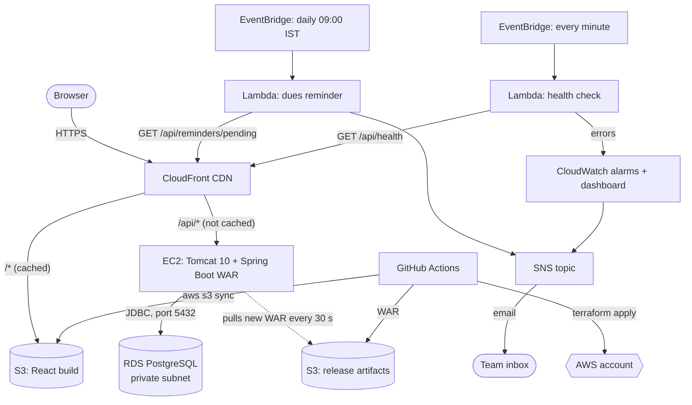

# SplitCloud

A cloud-native group expense splitting and settlement platform, built for the
Cloud Computing and DevOps (CSE 3130) mini project.

Groups record shared expenses with flexible splits, every member sees a live net
balance, and a settlement engine clears all debts in at most n − 1 payments, with
a UPI (Unified Payments Interface) link and QR code for each one. The focus of the
project is the cloud architecture and DevOps lifecycle around the app: everything
runs on managed AWS services, all infrastructure is Terraform, and every change
ships through GitHub Actions.

## Architecture



| Layer | AWS service | What it does here |
|---|---|---|
| Edge | CloudFront | Single HTTPS entry point; routes `/api/*` to EC2 and everything else to S3 |
| Frontend | S3 (Simple Storage Service) | Holds the static React build; private, readable only by CloudFront through Origin Access Control |
| Application | EC2 (Elastic Compute Cloud) + Elastic IP | Tomcat 10 running the Spring Boot WAR; only CloudFront's IP ranges can reach port 8080 |
| Data | RDS (Relational Database Service) PostgreSQL 16 | Private subnets, no internet route; only the app's security group can connect |
| Serverless | Lambda + EventBridge | Daily dues digest and a once-a-minute synthetic health check |
| Notifications | SNS (Simple Notification Service) | Emails alarms and the dues digest |
| Observability | CloudWatch | Alarms (API down, CPU, status checks, storage) and an overview dashboard |
| Network | VPC (Virtual Private Cloud), subnets, security groups | Public subnets for EC2, private subnets for RDS, least-access firewall rules |
| Access | IAM (Identity and Access Management) | Instance and Lambda roles (LabRole in AWS Academy) |
| IaC (Infrastructure as Code) | Terraform | Every resource above, with remote state in S3 |
| CI/CD (Continuous Integration / Continuous Deployment) | GitHub Actions | Test on every push; build, provision and release on every push to `main` |

## Repository layout

```
backend/    Spring Boot 3 REST API (Java 17), packaged as a WAR for Tomcat 10
frontend/   React 18 + Vite single-page app
infra/      Terraform for all AWS resources, Lambda source, EC2 bootstrap script
.github/    CI, deploy and destroy pipelines
```

## Deploying (browser only, no local tools needed)

1. **Start the AWS lab.** In AWS Academy Learner Lab, click *Start Lab* and wait for the green dot.
   Open *AWS Details* → *AWS CLI: Show*. You'll see three values.
2. **Add the credentials to GitHub.** In this repository: *Settings* → *Secrets and variables* → *Actions*.
   - *Secrets* tab → *New repository secret*, three times:
     `AWS_ACCESS_KEY_ID`, `AWS_SECRET_ACCESS_KEY`, `AWS_SESSION_TOKEN`
   - *Variables* tab → *New repository variable*: `ALERT_EMAIL` = your email address
   - Normal (non-Academy) AWS account? Also add variable `LAB_MODE` = `false`, and leave `AWS_SESSION_TOKEN` empty.
3. **Run the deployment.** *Actions* → *Deploy to AWS* → *Run workflow*. The first run takes
   about 15–20 minutes (the database and CloudFront are the slow parts).
4. **Confirm the email subscription.** AWS emails you "AWS Notification - Subscription Confirmation".
   Click the link, or you won't receive alarms or reminders.
5. **Open the app.** The workflow summary shows the app URL (`https://xxxx.cloudfront.net`).
   Click *Load sample trip* to get a populated group.

Learner Lab credentials expire when the lab session ends. Before re-running the
deploy in a new session, update the three secrets with the new values.

## Running locally

```bash
docker compose up -d                          # PostgreSQL on localhost:5432
cd backend && mvn spring-boot:run             # API on http://localhost:8080
cd frontend && npm install && npm run dev     # app on http://localhost:5173 (proxies /api)
```

## API

| Method | Path | Purpose |
|---|---|---|
| GET / POST | `/api/groups` | List or create groups |
| GET | `/api/groups/{id}` | Group with its members |
| POST | `/api/groups/{id}/members` | Add a member (name, email, UPI ID) |
| GET / POST | `/api/groups/{id}/expenses` | List or add expenses (EQUAL, EXACT, PERCENT, SHARES) |
| DELETE | `/api/groups/{id}/expenses/{expenseId}` | Remove an expense |
| GET | `/api/groups/{id}/balances` | Net position per member |
| GET | `/api/groups/{id}/settlement-plan` | Minimal payments to settle, with UPI links |
| GET / POST | `/api/groups/{id}/settlements` | Recorded repayments |
| GET | `/api/reminders/pending` | Everyone who owes money (read by the reminder Lambda) |
| GET | `/api/health` | Application and database health (read by the health-check Lambda) |
| POST | `/api/demo` | Create the sample "Goa Trip" group |

All money is integer paise. Splits use the largest-remainder method so they always add
up to the total exactly; settlement uses greedy debt simplification (at most n − 1 payments).

## Cost and teardown

Roughly US$0.04 per hour while running (t3.micro EC2, db.t3.micro RDS, Elastic IP;
Lambda, SNS, CloudWatch and CloudFront stay within free allowances at demo traffic).
When you're done: *Actions* → *Destroy AWS infrastructure* → *Run workflow* → type `destroy`.

## Known limitations

- Single EC2 instance and single-AZ (Availability Zone) database: the next step is an
  Auto Scaling group behind a load balancer across two AZs and a Multi-AZ RDS deployment.
- No user accounts: anyone with the URL can see every group. Production would add
  authentication (for example Amazon Cognito) and per-group access control.
- Database credentials are passed to Tomcat through the instance's user data. AWS Secrets
  Manager would be the production choice.
- Schema is managed by Hibernate `ddl-auto=update`; production would use Flyway migrations.
