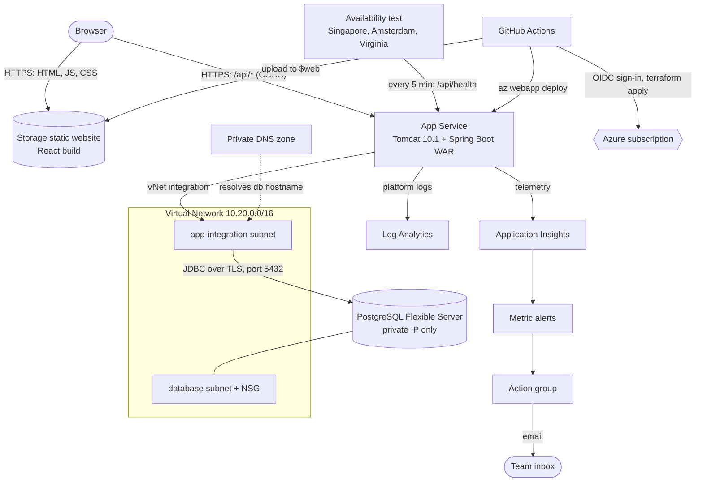

# SplitCloud

A cloud-native group expense splitting and settlement platform, built for the
Cloud Computing and DevOps (CSE 3130) mini project.

Groups record shared expenses with flexible splits, every member sees a live net
balance, and a settlement engine clears all debts in at most n − 1 payments, with
a UPI (Unified Payments Interface) link and QR code for each one. The focus of the
project is the cloud architecture and DevOps lifecycle around the app: everything
runs on managed Azure services, all infrastructure is Terraform, and every change
ships through GitHub Actions.

## Architecture



| Layer | Azure service | What it does here |
|---|---|---|
| Frontend | Storage account static website | Serves the React build straight from blob storage, no server to manage |
| Application | App Service (Linux, B1) | Managed Tomcat 10.1 on Java 17 running the Spring Boot WAR; HTTPS only, health check on `/api/health` |
| Data | Azure Database for PostgreSQL Flexible Server 16 | Injected into a private subnet; public access disabled; TLS required |
| Network | VNet (Virtual Network), subnets, NSG (Network Security Group), Private DNS | API reaches the database privately; the database subnet accepts port 5432 only from the app subnet |
| Observability | Application Insights, Log Analytics | Request telemetry, platform logs, and an availability test from three regions |
| Alerting | Azure Monitor metric alerts + action group | Emails on API down, 5xx errors, high CPU, database storage |
| IaC (Infrastructure as Code) | Terraform (azurerm) | Every resource above, with remote state in an Azure Storage container |
| CI/CD (Continuous Integration / Continuous Deployment) | GitHub Actions | Test on every push; provision and release on every push to `main` |
| Identity | Managed identity + OIDC (OpenID Connect) federation | GitHub signs in to Azure with short-lived tokens; no stored passwords |

## Repository layout

```
backend/    Spring Boot 3 REST API (Java 17), packaged as a WAR for Tomcat 10.1
frontend/   React 18 + Vite single-page app
infra/      Terraform for all Azure resources
.github/    CI, deploy and destroy pipelines
```

## Deploying

**One-time setup (Azure Cloud Shell).** Creates a managed identity that GitHub can
sign in as, trusts this repository's `main` branch, and gives it Contributor on the
subscription. The script prints four values.

**Add them to GitHub.** *Settings* → *Secrets and variables* → *Actions* → *Variables*:
`AZURE_CLIENT_ID`, `AZURE_TENANT_ID`, `AZURE_SUBSCRIPTION_ID`, `AZURE_LOCATION`, and
optionally `ALERT_EMAIL`. These are identifiers, not passwords.

**Deploy.** *Actions* → *Deploy to Azure* → *Run workflow*. The first run takes about
10–15 minutes (the database is the slow part). The run summary shows the app URL.
After that, every push to `main` redeploys automatically.

## Running locally

```bash
docker compose up -d                          # PostgreSQL on localhost:5432
cd backend && mvn spring-boot:run             # API on http://localhost:8080
cd frontend && npm install && npm run dev     # app on http://localhost:5173 (proxies /api)
```

## API

| Method | Path | Purpose |
|---|---|---|
| GET / POST | `/api/groups` | List or create groups |
| GET | `/api/groups/{id}` | Group with its members |
| POST | `/api/groups/{id}/members` | Add a member (name, email, UPI ID) |
| PUT / DELETE | `/api/groups/{id}/members/{memberId}` | Edit a member, or remove one who has no expenses (409 otherwise) |
| GET / POST | `/api/groups/{id}/expenses` | List or add expenses (EQUAL, EXACT, PERCENT, SHARES) |
| PUT / DELETE | `/api/groups/{id}/expenses/{expenseId}` | Change an expense's description, category or date, or remove it |
| GET | `/api/groups/{id}/balances` | Net position per member |
| GET | `/api/groups/{id}/settlement-plan` | Minimal payments to settle, with UPI links |
| GET / POST | `/api/groups/{id}/settlements` | Recorded repayments |
| PUT / DELETE | `/api/groups/{id}/settlements/{settlementId}` | Change the date a payment was made, or undo it |
| GET | `/api/reminders/pending` | Everyone who owes money |
| GET | `/api/health` | Application and database health |
| POST | `/api/demo` | Create the sample "Goa Trip" group |

All money is integer paise. Splits use the largest-remainder method so they always add
up to the total exactly; settlement uses greedy debt simplification (at most n − 1 payments).

## Cost and teardown

Roughly US$1 per day while running (B1 App Service plan and B1ms PostgreSQL are most of it),
well within Azure for Students credit. When you're done: *Actions* →
*Destroy Azure infrastructure* → *Run workflow* → type `destroy`.

## Known limitations and next steps

- One App Service instance and a single-zone database. Next: scale out to two or more
  instances and enable zone-redundant high availability on PostgreSQL.
- No user accounts: anyone with the URL can see every group. Next: Microsoft Entra ID
  sign-in and per-group access control.
- The database password is an App Service setting. Next: Azure Key Vault references.
- Frontend served from storage directly. Next: Azure Front Door for a CDN (Content
  Delivery Network) and a single origin, which would also remove the need for CORS.
- Schema is managed by Hibernate `ddl-auto=update`. Next: versioned Flyway migrations.
- Scheduled dues reminders (an Azure Functions timer trigger reading `/api/reminders/pending`).
